# MH Training · imagens para o Instagram

Página de **avaliação**. Cada imagem tem um código (o mesmo do nome do arquivo). Quem aprova é o Matheus; nada é agendado sem o ok.
Nenhuma imagem desta página contém o link do app.

## Carrossel Apresente-se (8 slides, 1080 × 1350, feito pelo Codex)
Post para ficar fixado no perfil. Aprovação por slide ou do conjunto.
<table>
<tr><td valign="top" width="280">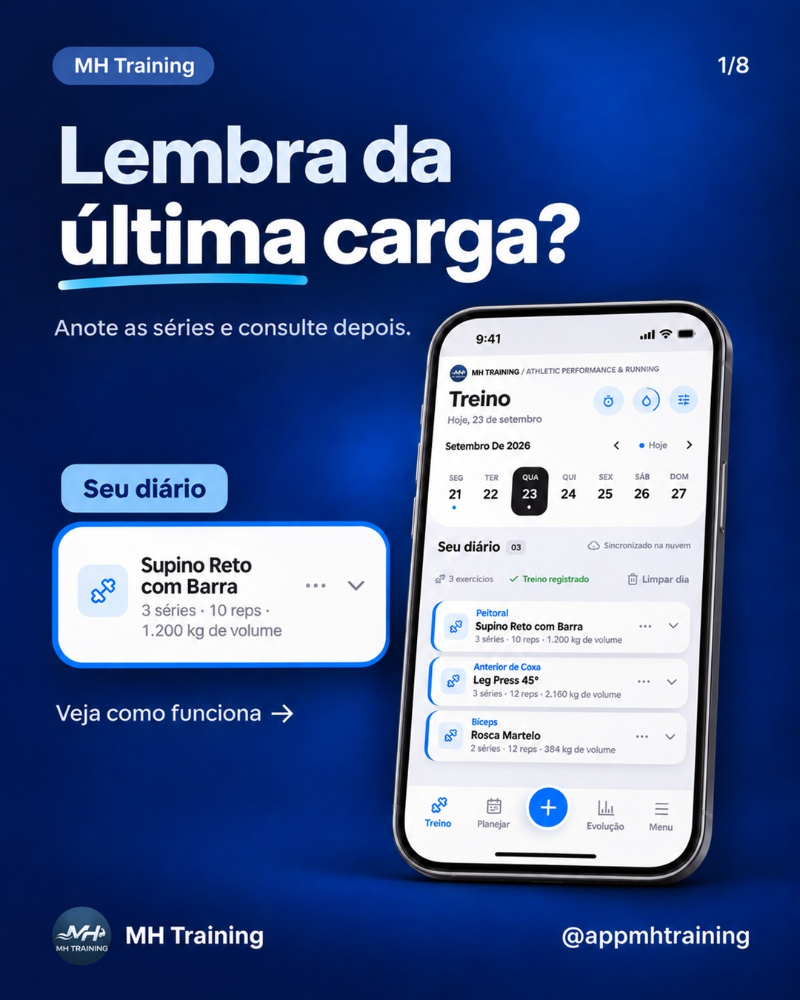 <b>A01 · Capa: Lembra da última carga?</b></td><td valign="top" width="280">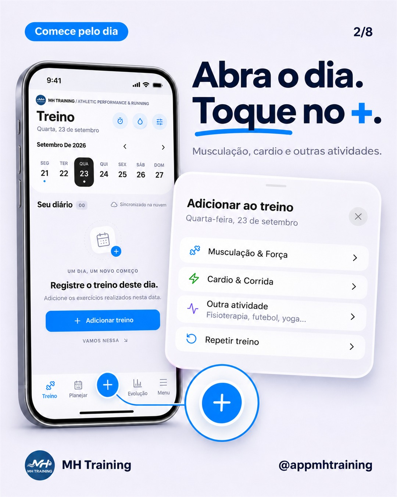 <b>A02 · Abra o dia, toque no +</b></td><td valign="top" width="280">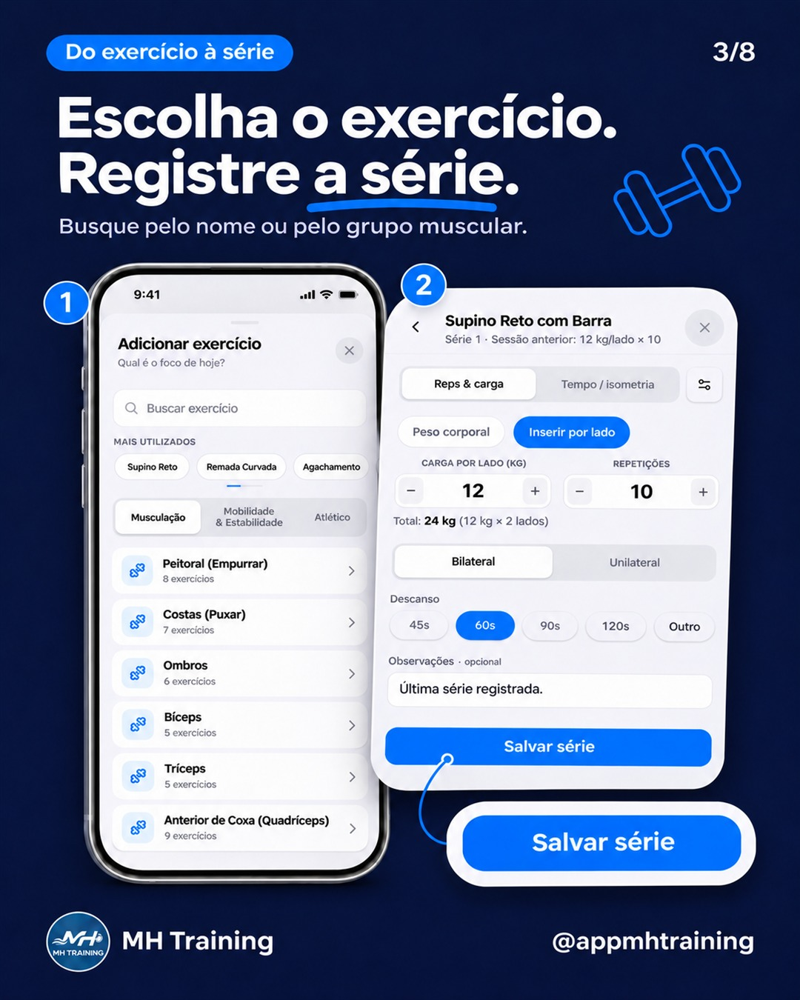 <b>A03 · Escolha o exercício, registre a série</b></td><td valign="top" width="280">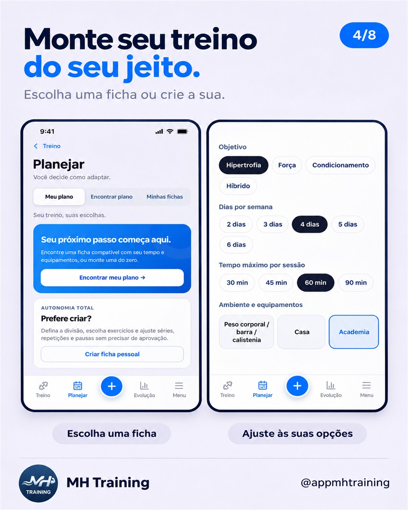 <b>A04 · Monte seu treino</b></td></tr>
<tr><td valign="top" width="280">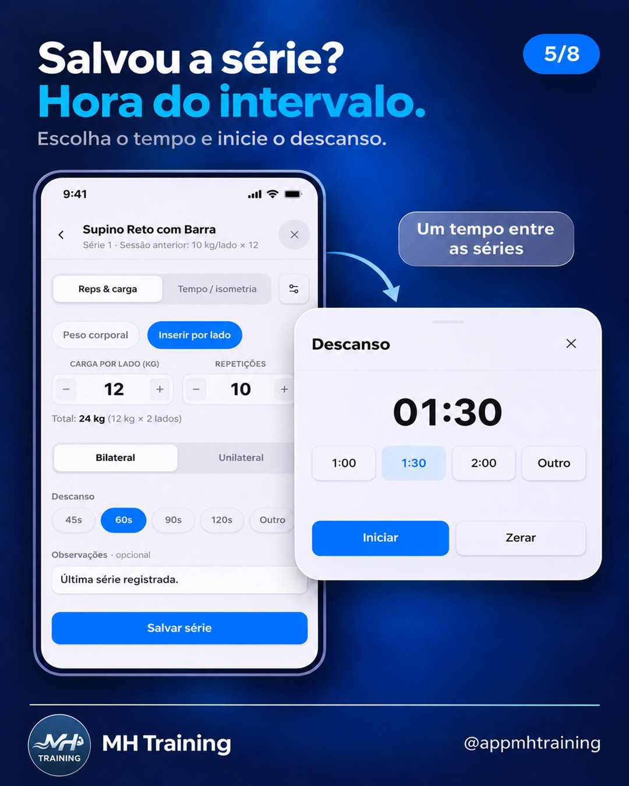 <b>A05 · Hora do intervalo</b></td><td valign="top" width="280">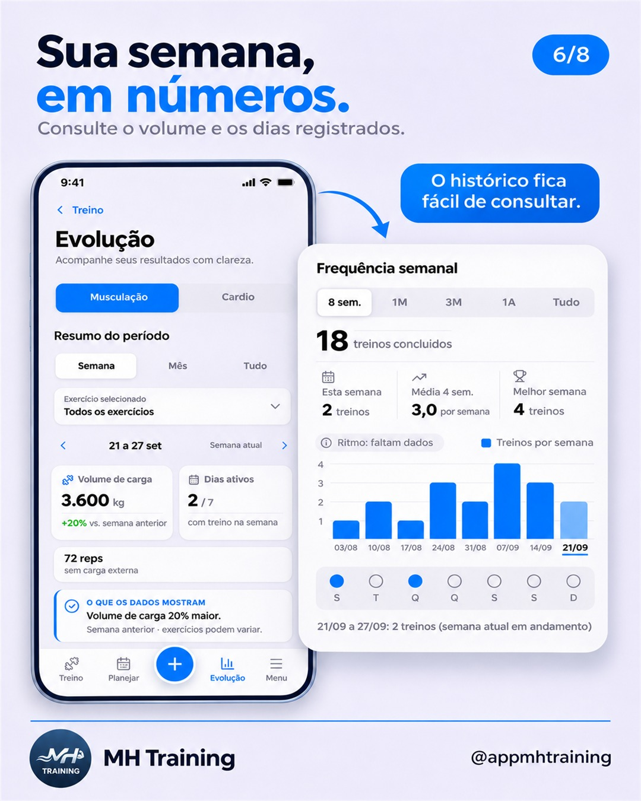 <b>A06 · Sua semana em números</b></td><td valign="top" width="280">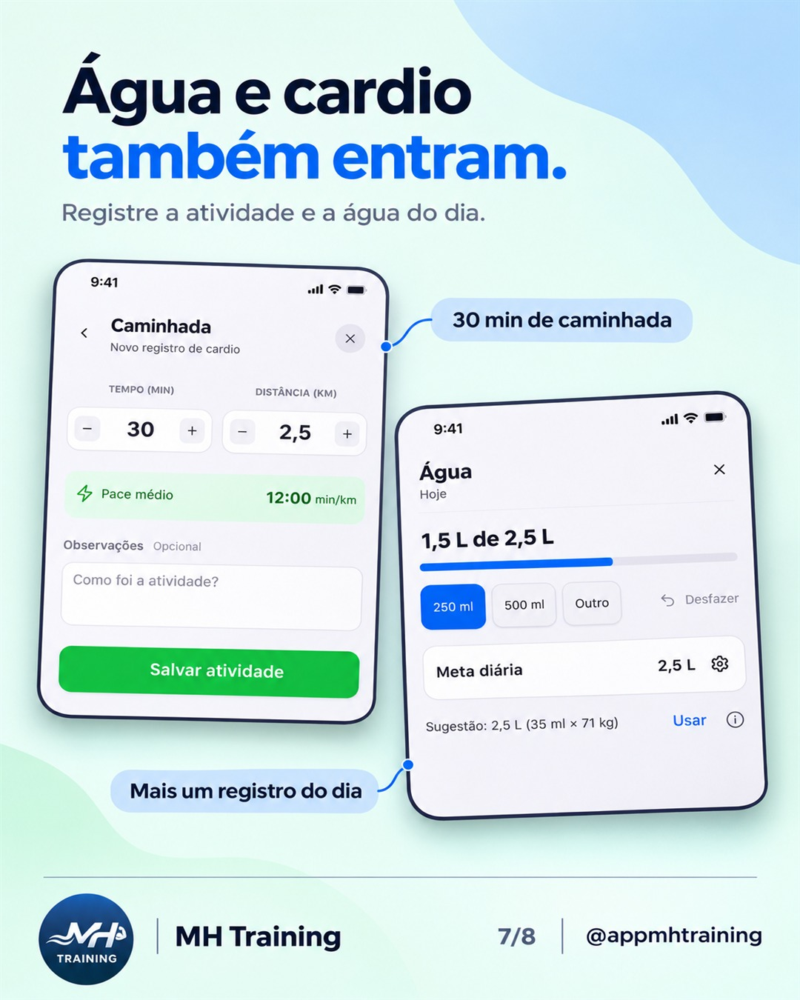 <b>A07 · Água e cardio</b></td><td valign="top" width="280"> <b>A08 · Quer testar? Comente quero</b></td></tr>
</table>

## Feed (1080 × 1350)
<table>
<tr><td valign="top" width="280">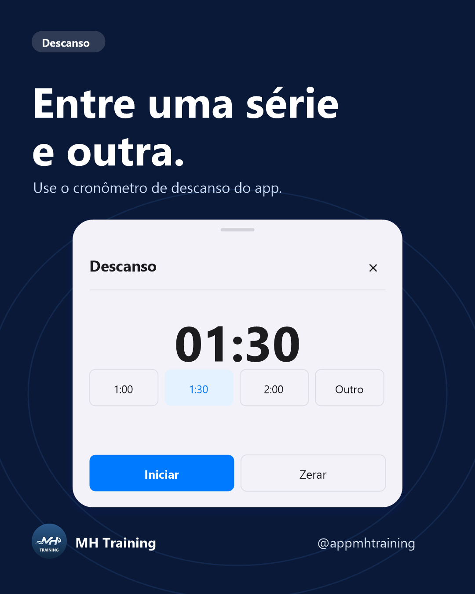 <b>P02 · Descanso entre séries</b> Pronta, legenda aprovada</td><td valign="top" width="280"> <b>P03 · A semana passa, o registro fica</b> Pronta, legenda aprovada</td><td valign="top" width="280">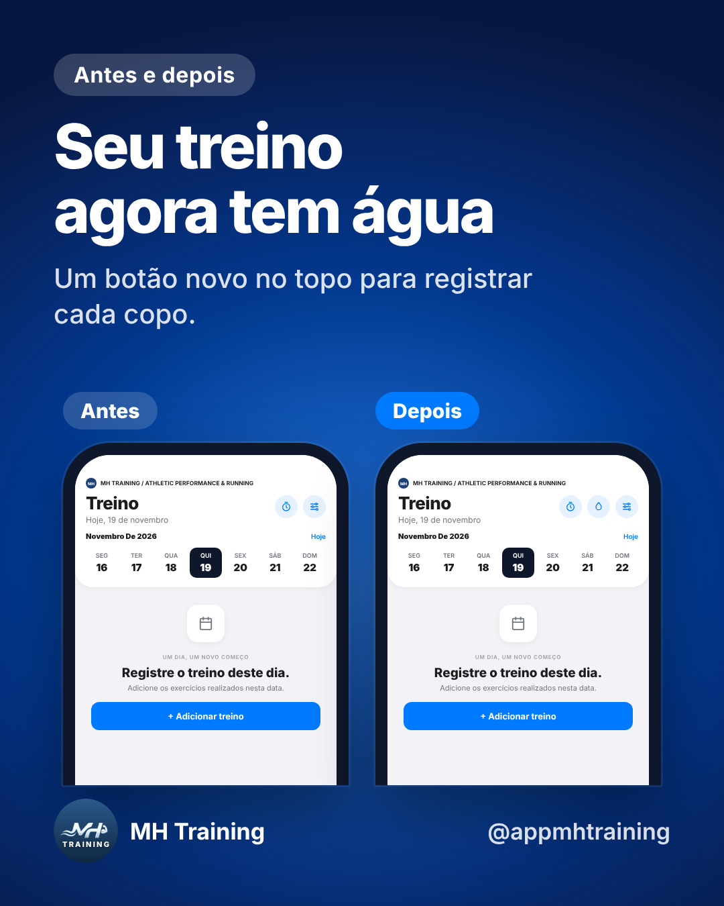 <b>F03 · Antes e depois: água</b> Botão novo de água no topo</td></tr>
<tr><td valign="top" width="280">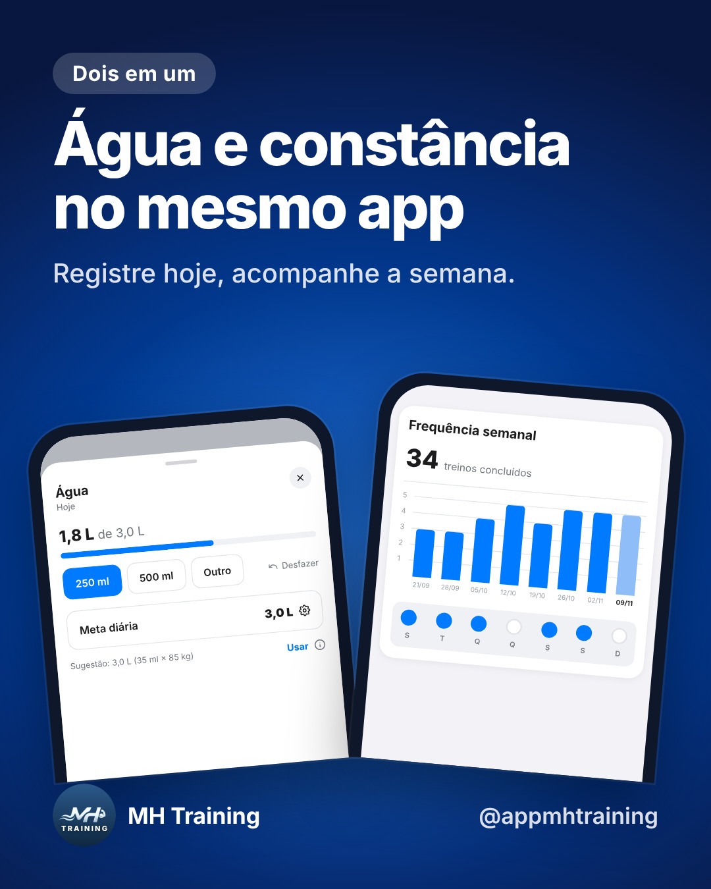 <b>F04 · Dois em um</b> Água e frequência no mesmo app</td><td valign="top" width="280">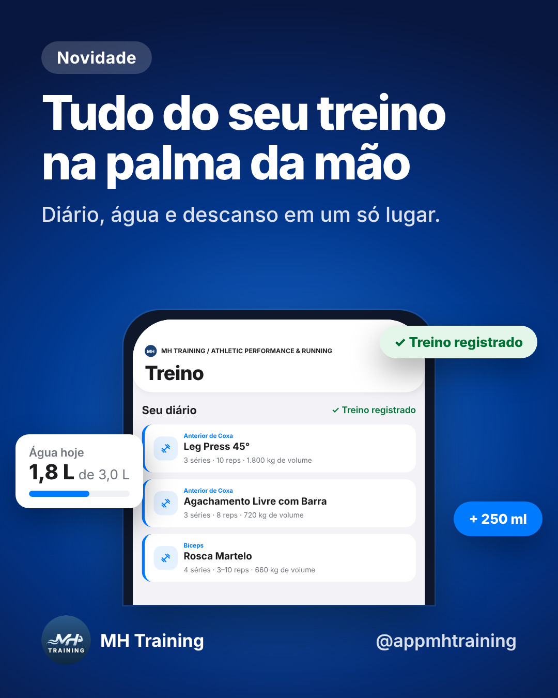 <b>F05 · Tudo na palma da mão</b> Cartões flutuantes</td><td valign="top" width="280"> <b>F06 · Sua constância, semana a semana</b> Gráfico de frequência</td></tr>
<tr><td valign="top" width="280"> <b>F07 · Treino anotado não se perde</b> Frase simples</td><td valign="top" width="280"> <b>F10 · Quanto de água você bebeu hoje?</b> Registro de água</td><td valign="top" width="280"> <b>F11 · Treino não é só academia</b> Outra atividade</td></tr>
</table>

## Stories (1080 × 1920)
<table>
<tr><td valign="top" width="280"> <b>S02 · Excluir série pede confirmação</b> Corrigido</td><td valign="top" width="280"> <b>S03 · Anote a carga de cada série</b> Dica de treino</td><td valign="top" width="280"> <b>S04 · Quer testar o MH Training?</b> Convite, sem link</td></tr>
<tr><td valign="top" width="280">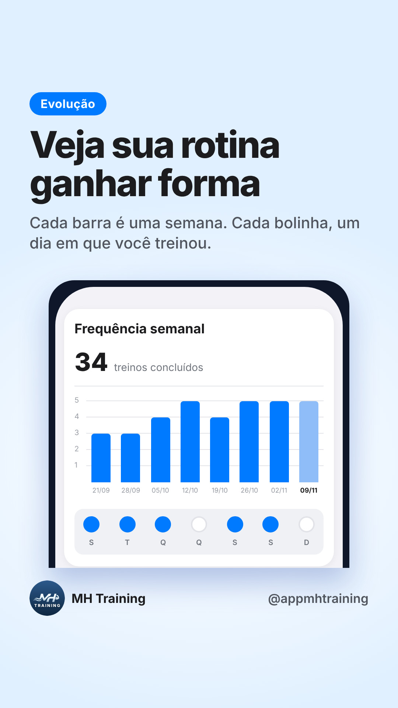 <b>S06 · Veja sua rotina ganhar forma</b> Evolução</td><td valign="top" width="280">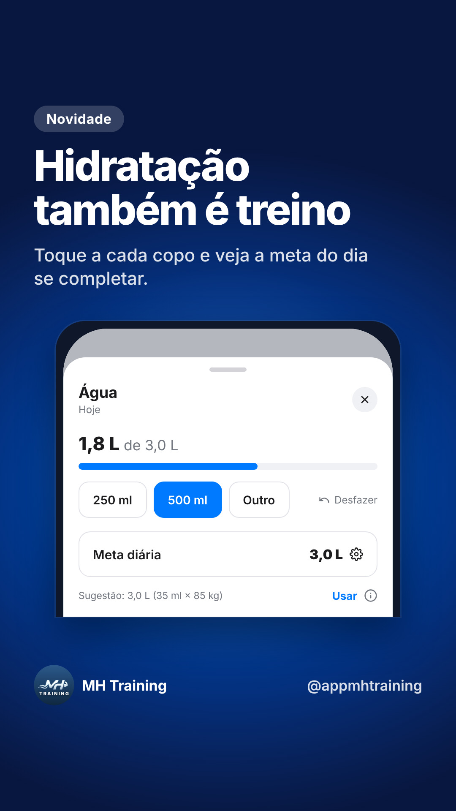 <b>S07 · Hidratação também é treino</b> Novidade: água</td><td valign="top" width="280"> <b>S08 · Seu treino cabe em qualquer lugar</b> Novidade: outra atividade</td></tr>
<tr><td valign="top" width="280"> <b>S09 · Em construção</b> Teaser</td></tr>
</table>

## Em atualização pelo Codex (retiradas daqui até voltarem corrigidas)
- F08 Bateu a meta · F09 Sessão anterior · Carrossel C1 (6 slides) · S01 Descanso começa sozinho · S05 Um treino, quatro passos.

## Já postadas (retiradas)
- P01 Diário (postada em 20/11) · F12 Em construção (feed).
