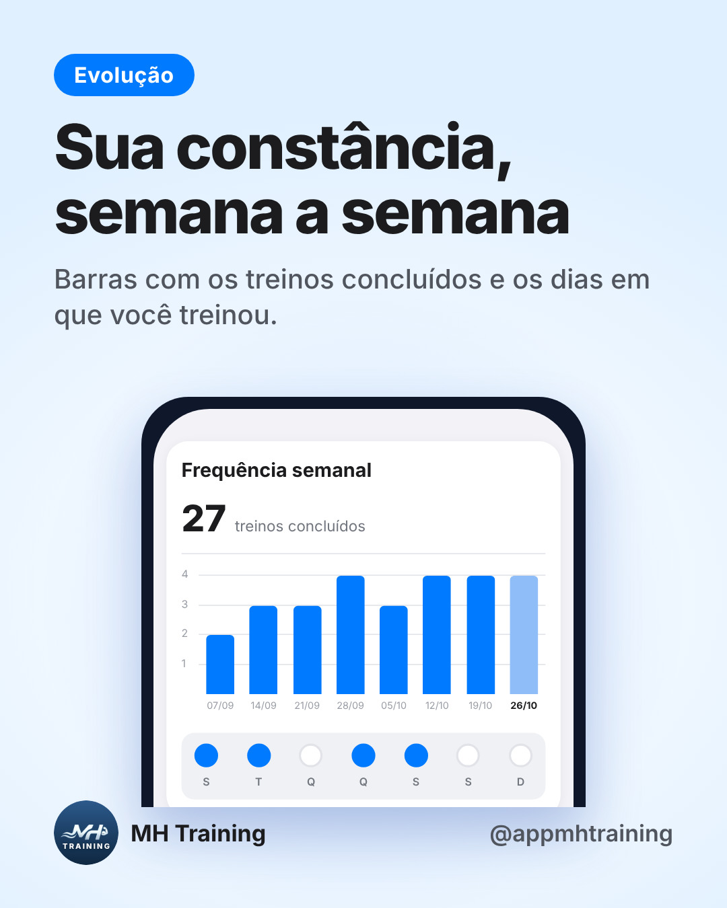
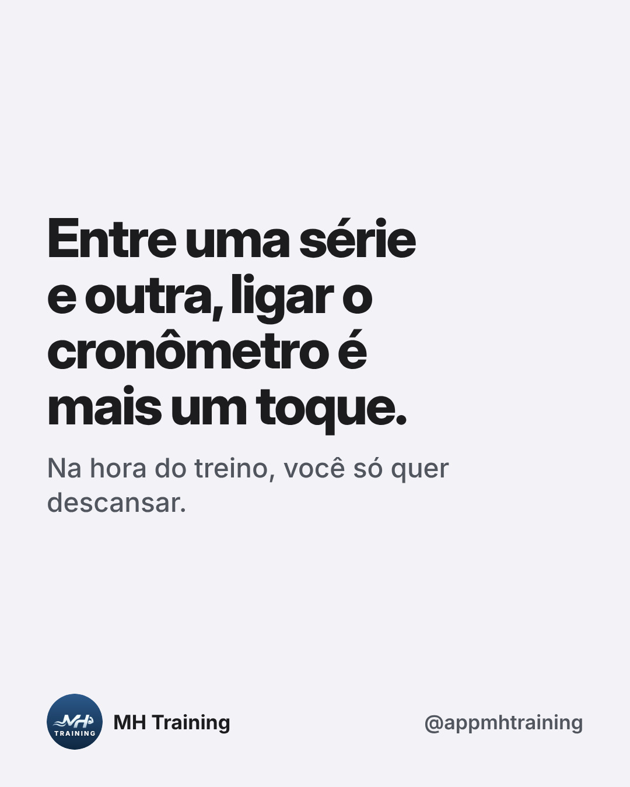
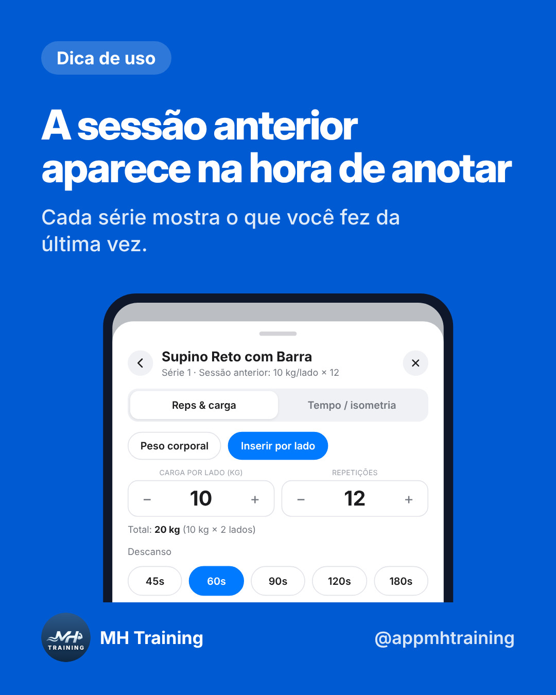
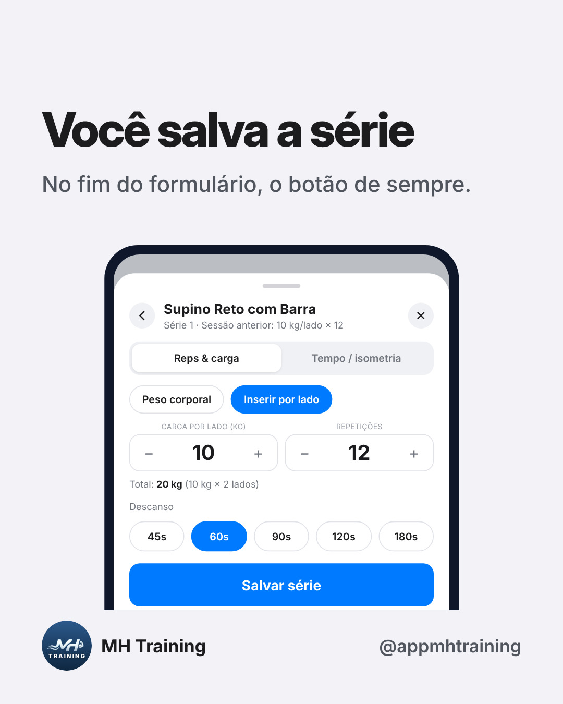
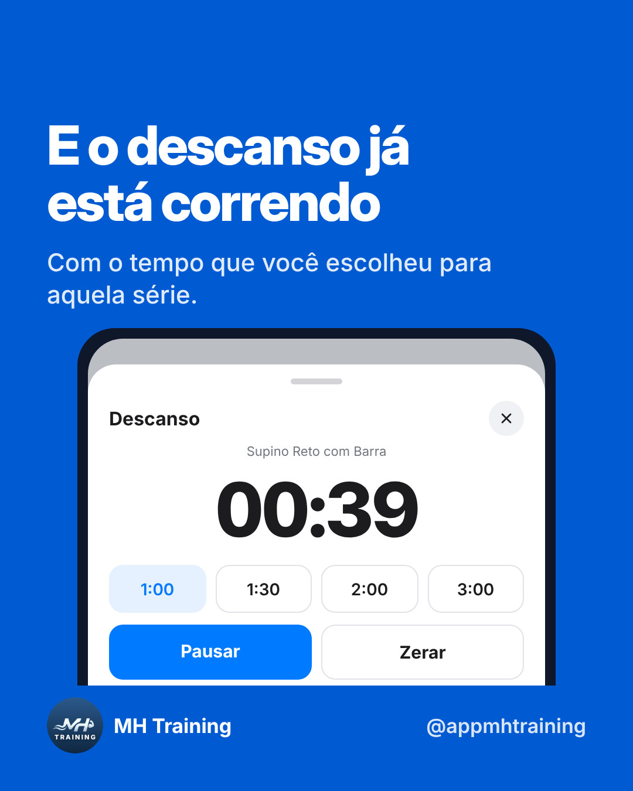
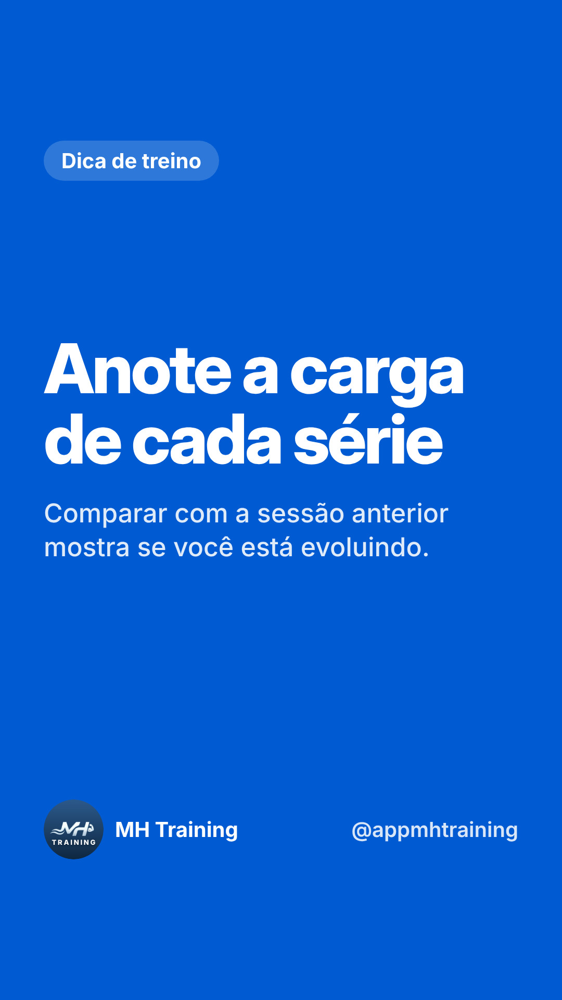
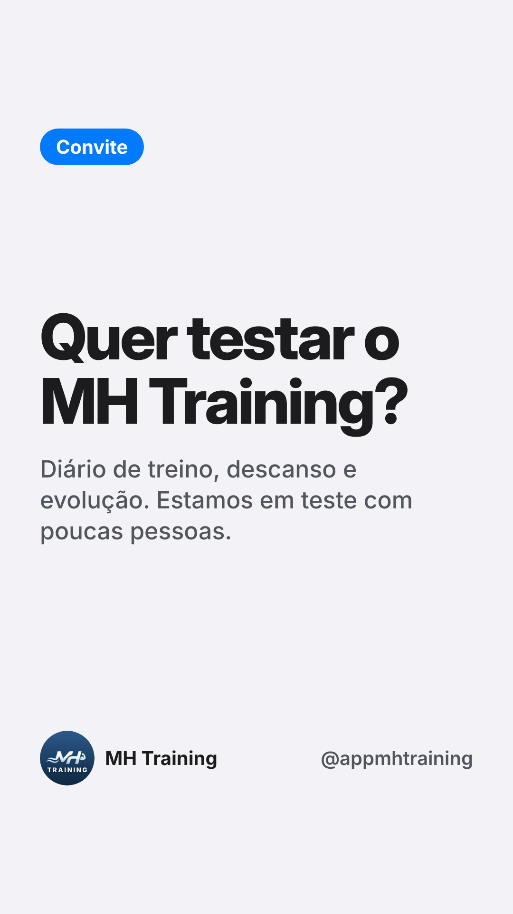
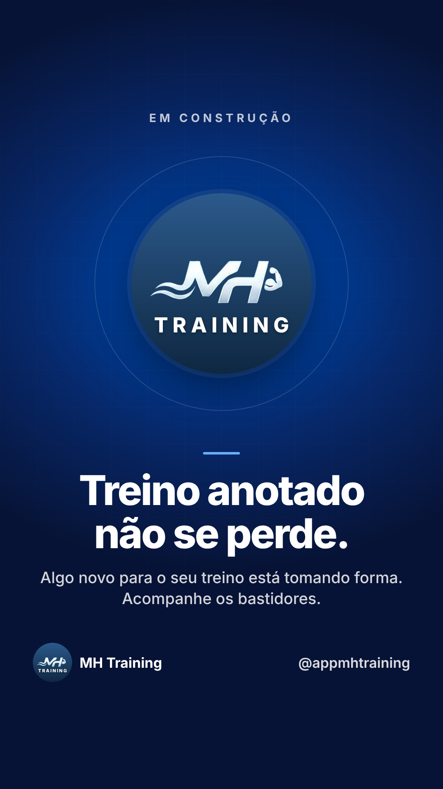

# MH Training · imagens para o Instagram

Página de **avaliação**. Cada imagem tem um código (o mesmo do nome do arquivo). Quem aprova é o Matheus; nada é agendado sem o ok.
Nenhuma imagem desta página contém o link do app.

## Feed (1080 × 1350) · para avaliar
<table>
<tr><td valign="top" width="280"> <b>P01 · Diário</b> JÁ POSTADA em 20/11</td><td valign="top" width="280"> <b>P02 · Descanso entre séries</b> Pronta, legenda aprovada</td><td valign="top" width="280"> <b>P03 · A semana passa, o registro fica</b> Pronta, legenda aprovada</td></tr>
<tr><td valign="top" width="280"> <b>F03 · Antes e depois: água</b> Botão novo de água no topo</td><td valign="top" width="280"> <b>F04 · Dois em um</b> Água e frequência no mesmo app</td><td valign="top" width="280"> <b>F05 · Tudo na palma da mão</b> Cartões flutuantes: diário, água, descanso</td></tr>
<tr><td valign="top" width="280"> <b>F06 · Sua constância, semana a semana</b> Gráfico de frequência</td><td valign="top" width="280"> <b>F07 · Treino anotado não se perde</b> Frase simples</td><td valign="top" width="280"> <b>F10 · Quanto de água você bebeu hoje?</b> Registro de água</td></tr>
<tr><td valign="top" width="280"> <b>F11 · Treino não é só academia</b> Outra atividade</td></tr>
</table>

## Feed · carrossel C1 "O cronômetro que começa sozinho" (slides que estão ok)
<table>
<tr><td valign="top" width="280"> <b>C1 slide 1 · Capa</b> O cronômetro que começa sozinho</td><td valign="top" width="280"> <b>C1 slide 2 · Problema</b> Entre uma série e outra</td><td valign="top" width="280"> <b>C1 slide 6 · Próximo capítulo</b> Não perder série</td></tr>
</table>

## Feed · telas desatualizadas, precisam ser refeitas antes de postar
<table>
<tr><td valign="top" width="280"> <b>F09 · A sessão anterior aparece</b> ⚠ tela do registro de série desatualizada (Descanso mostra 180s; o app mostra Outro; faltam o botão de filtro e o Bilateral/Unilateral)</td><td valign="top" width="280"> <b>C1 slide 3 · Você salva a série</b> ⚠ mesma tela de série desatualizada</td><td valign="top" width="280"> <b>C1 slide 4 · Descanso correndo</b> ⚠ presets 1:00 1:30 2:00 3:00; o app mostra Outro no lugar de 3:00</td></tr>
<tr><td valign="top" width="280"> <b>C1 slide 5 · Você escolhe o descanso</b> ⚠ mostra 180s; o app mostra Outro</td></tr>
</table>

## Stories (1080 × 1920)
<table>
<tr><td valign="top" width="280"> <b>S01 · Descanso começa sozinho</b> ⚠ presets 1:00 1:30 2:00 3:00 (app mostra Outro)</td><td valign="top" width="280"> <b>S02 · Excluir série pede confirmação</b> Corrigido</td><td valign="top" width="280"> <b>S03 · Anote a carga de cada série</b> Dica de treino</td></tr>
<tr><td valign="top" width="280"> <b>S04 · Quer testar o MH Training?</b> Convite, sem link</td><td valign="top" width="280"> <b>S05 · Um treino, quatro passos</b> A conferir: telas pequenas</td><td valign="top" width="280"> <b>S06 · Veja sua rotina ganhar forma</b> Evolução</td></tr>
<tr><td valign="top" width="280"> <b>S07 · Hidratação também é treino</b> Novidade: água</td><td valign="top" width="280"> <b>S08 · Seu treino cabe em qualquer lugar</b> Novidade: outra atividade</td><td valign="top" width="280"> <b>S09 · Em construção</b> Teaser</td></tr>
</table>

## Retiradas
- F08 "Bateu a meta?" (tela antiga, com ícone que não existe no app): a refazer.
- F12 "Em construção" (feed): já postada no Instagram.
