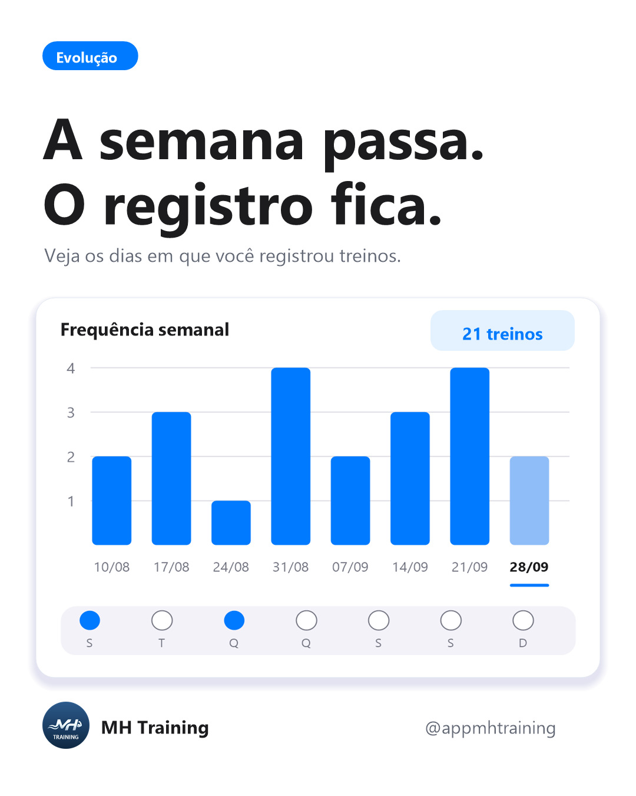
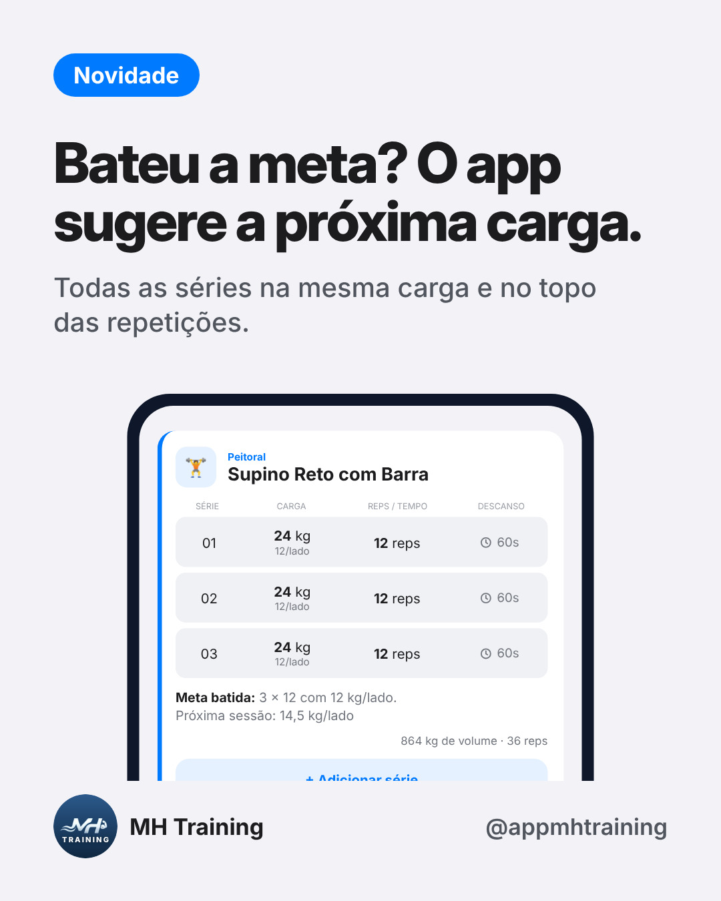
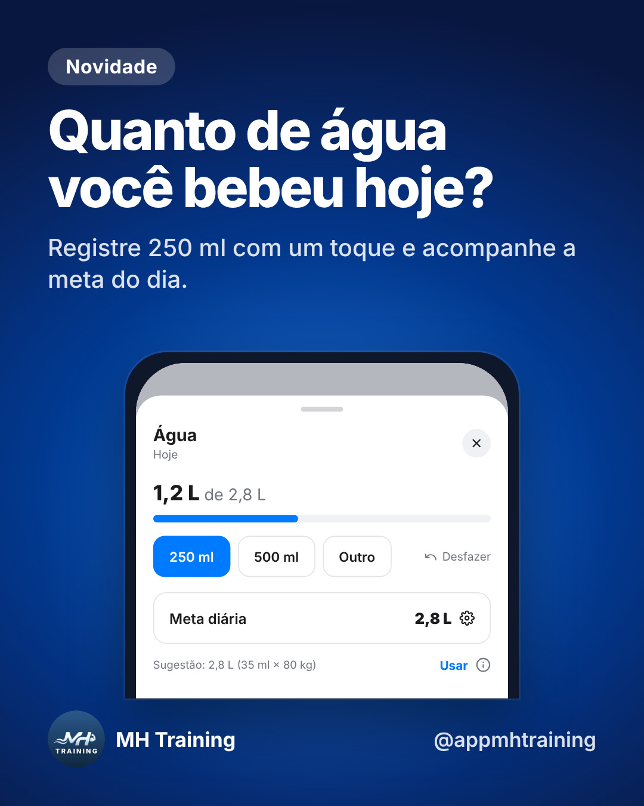
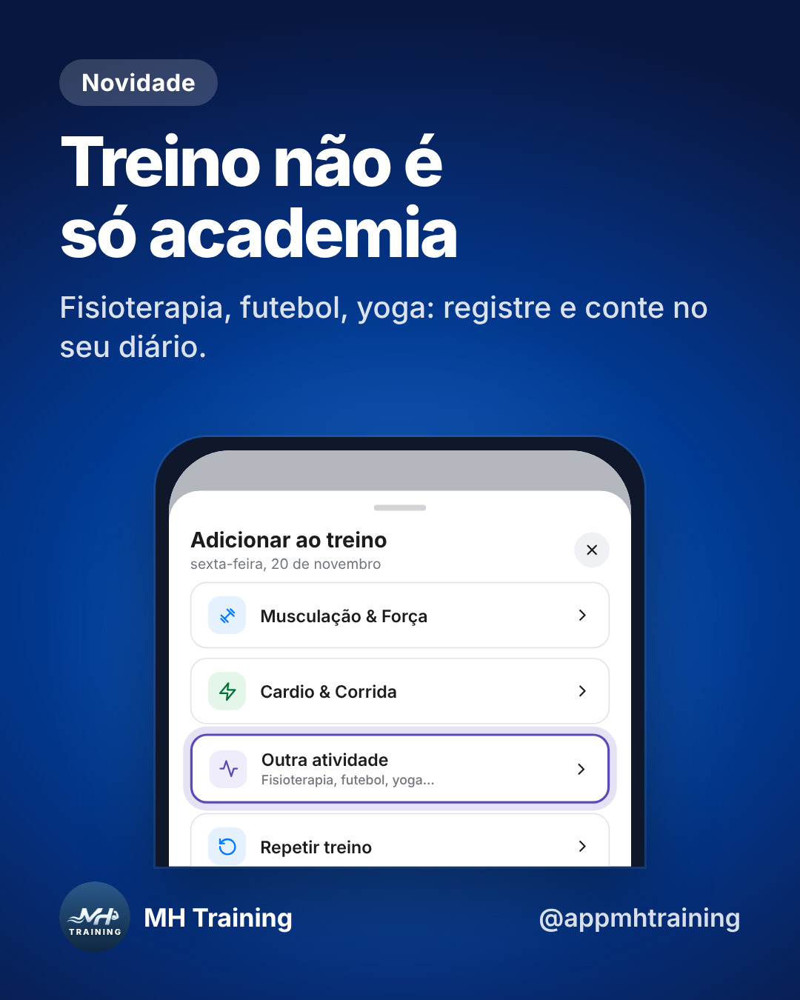
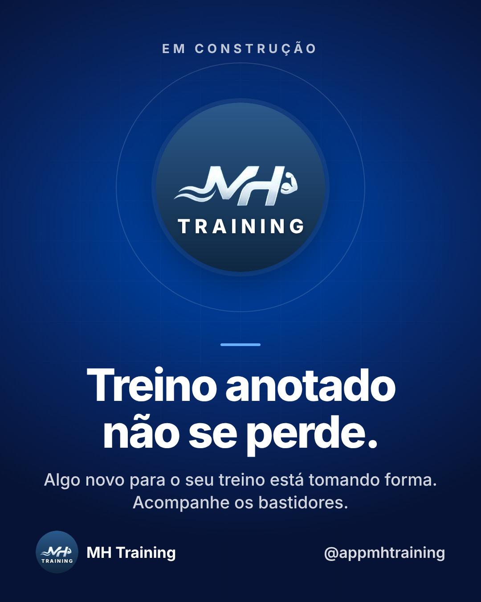
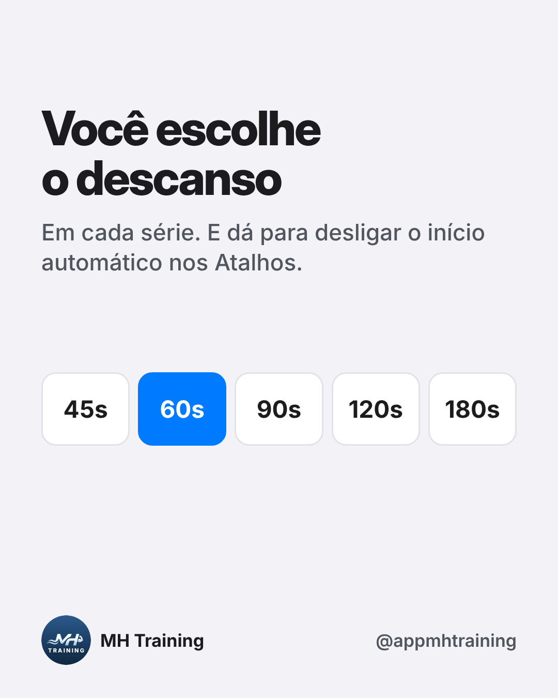
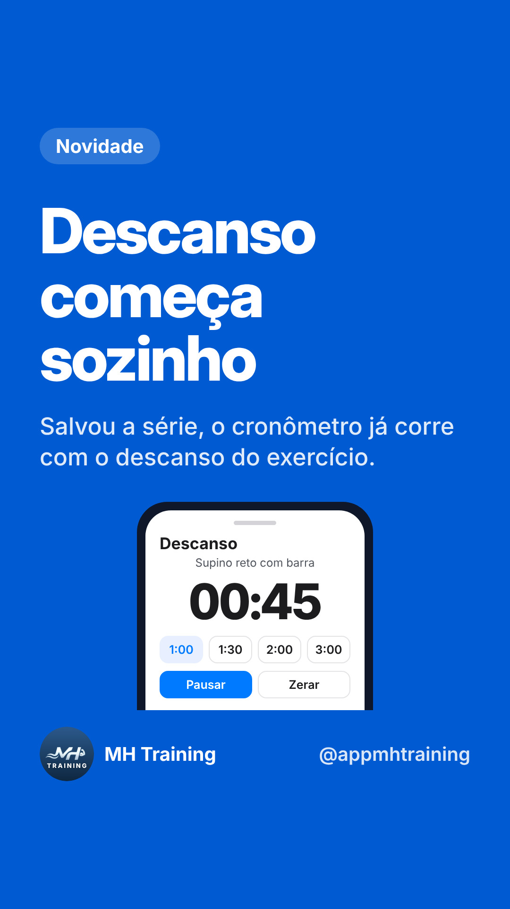
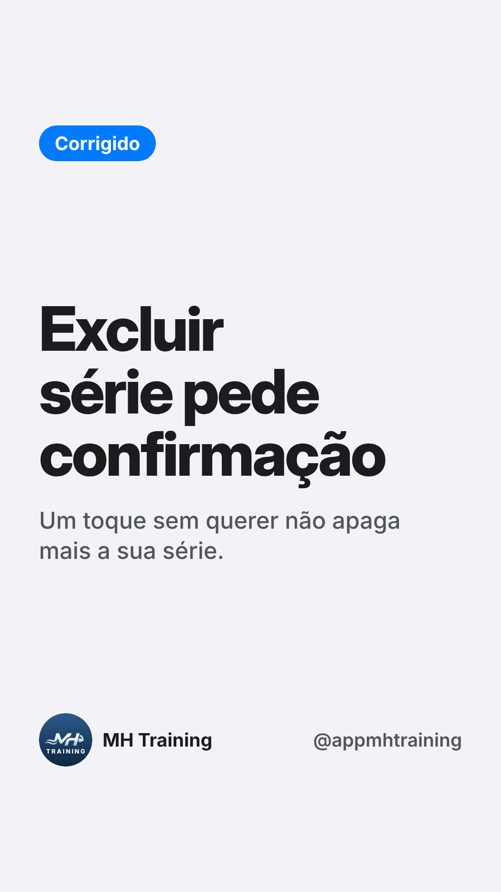
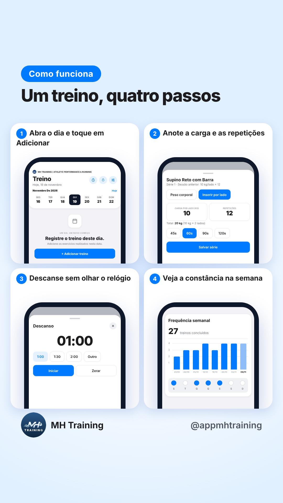
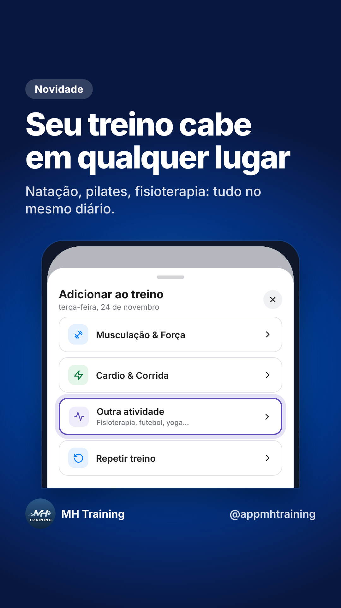

# MH Training · imagens para o Instagram

Página de **avaliação**. Cada imagem tem um número. Quem aprova é o Matheus; nada é agendado sem o ok.
Nenhuma imagem desta página contém o link do app.

## Feed (1080 × 1350)
<table>
<tr><td valign="top" width="280"> <b>F01 · Diário</b> JÁ POSTADA em 20/11</td><td valign="top" width="280"> <b>F02 · Descanso entre séries</b> Pronta, legenda aprovada</td><td valign="top" width="280"> <b>F03 · A semana passa, o registro fica</b> Pronta, legenda aprovada</td></tr>
<tr><td valign="top" width="280"> <b>F04 · Antes e depois: água</b> Botão novo de água no topo</td><td valign="top" width="280"> <b>F05 · Dois em um</b> Água e frequência no mesmo app</td><td valign="top" width="280"> <b>F06 · Tudo na palma da mão</b> Cartões flutuantes: diário, água, descanso</td></tr>
<tr><td valign="top" width="280"> <b>F07 · Sua constância, semana a semana</b> Gráfico de frequência</td><td valign="top" width="280"> <b>F08 · Treino anotado não se perde</b> Frase simples</td><td valign="top" width="280"> <b>F09 · Bateu a meta?</b> App sugere a próxima carga</td></tr>
<tr><td valign="top" width="280"> <b>F10 · A sessão anterior aparece</b> Na hora de anotar</td><td valign="top" width="280"> <b>F11 · Quanto de água você bebeu hoje?</b> Registro de água</td><td valign="top" width="280"> <b>F12 · Treino não é só academia</b> Outra atividade</td></tr>
<tr><td valign="top" width="280"> <b>F13 · Em construção</b> Teaser</td></tr>
</table>

## Carrossel C1 · "O cronômetro que começa sozinho" (6 slides, 1 post)
<table>
<tr><td valign="top" width="280"> <b>Slide 1</b> Capa: O cronômetro que começa sozinho</td><td valign="top" width="280"> <b>Slide 2</b> Entre uma série e outra</td><td valign="top" width="280"> <b>Slide 3</b> Você salva a série</td></tr>
<tr><td valign="top" width="280"> <b>Slide 4</b> E o descanso já está correndo</td><td valign="top" width="280"> <b>Slide 5</b> Você escolhe o descanso</td><td valign="top" width="280"> <b>Slide 6</b> Não perder série (próximo capítulo)</td></tr>
</table>

## Stories (1080 × 1920)
<table>
<tr><td valign="top" width="280"> <b>S01 · Descanso começa sozinho</b> Novidade</td><td valign="top" width="280"> <b>S02 · Excluir série pede confirmação</b> Corrigido</td><td valign="top" width="280"> <b>S03 · Anote a carga de cada série</b> Dica de treino</td></tr>
<tr><td valign="top" width="280"> <b>S04 · Quer testar o MH Training?</b> Convite, sem link</td><td valign="top" width="280"> <b>S05 · Um treino, quatro passos</b> Como funciona</td><td valign="top" width="280"> <b>S06 · Veja sua rotina ganhar forma</b> Evolução</td></tr>
<tr><td valign="top" width="280"> <b>S07 · Hidratação também é treino</b> Novidade: água</td><td valign="top" width="280"> <b>S08 · Seu treino cabe em qualquer lugar</b> Novidade: outra atividade</td><td valign="top" width="280"> <b>S09 · Em construção</b> Teaser</td></tr>
</table>
